# Tier 1-2 Technical Support Ticket Lab

Six network support tickets worked end to end in a virtualized enterprise environment. Each ticket documents the reported problem, the tools chosen and why, the troubleshooting steps taken, the root cause, and the verified resolution. Screenshots from the lab appear at the step they prove.

## Environment

- **Servers:** Windows Server 2019 (DNS / domain controller), Ubuntu Linux servers
- **Endpoints:** Windows 10 workstations
- **Network:** OPNsense firewall, VyOS routers, DMZ architecture
- **Tools:** DNS Manager, Wireshark, nmap, pfTop, VyOS CLI, PuTTY, TightVNC, Windows Network Diagnostics, ipconfig, ping, traceroute/tracert, nslookup

## Tickets

| # | Issue | Root cause |
|---|---|---|
| 1 | [Users redirected to an unexpected site](#ticket-1-dns-redirection) | Incorrect DNS A records |
| 2 | [Unauthorized FTP service on the network](#ticket-2-unauthorized-ftp-service) | Anonymous FTP server in the DMZ |
| 3 | [Linux server cannot reach any network](#ticket-3-linux-server-cannot-reach-any-network) | Routing loop from a bad default route |
| 4 | [Workstation has no network access](#ticket-4-workstation-has-no-network-access) | DHCP failure causing APIPA fallback |
| 5 | [DMZ server unreachable after a firewall change](#ticket-5-dmz-server-unreachable-after-a-firewall-change) | Overly broad block rule |
| 6 | [Services running outside the approved baseline](#ticket-6-services-outside-the-approved-baseline) | 10 unauthorized listening ports |

---

## Ticket 1: DNS Redirection

**Reported**
```
Multiple employees in the USER_Net subnet cannot reach www.wgu.edu and are being redirected to a
suspicious site. The issue affects the entire organization. The server team recently installed
updates to DMZ_Server_3, which acts as the DNS server. The resolution must be organization-wide.
```

**Tools used:** DNS Manager, TightVNC, web browser, connectivity testing

**Why these tools:** The symptom was name resolution, so DNS Manager gave direct access to the zone records. TightVNC was needed to reach the DNS server console remotely. The browser confirmed the redirect and verified the fix.

**Troubleshooting process**

1. Verified the issue by attempting to access www.wgu.edu, which resulted in a "Server Not Found" error

   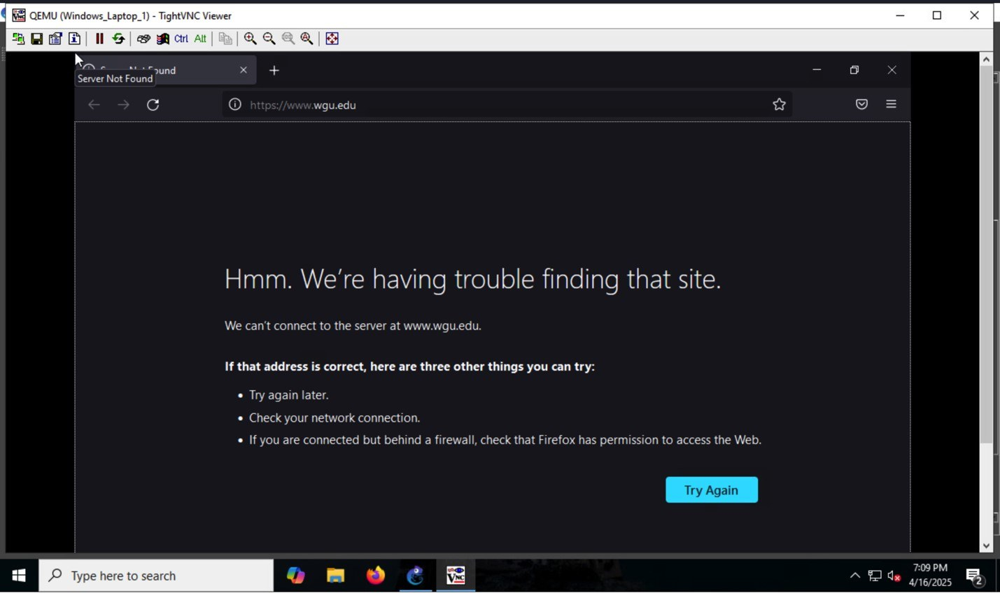

   *Firefox on Windows_Laptop_1 cannot load www.wgu.edu.*

2. Accessed the DNS server on DMZ_Server_3 using TightVNC Viewer to examine its configuration
3. In DNS Manager, examined the forward lookup zone for wgu.edu and discovered both the root domain (wgu.edu) and the www subdomain were configured with Host (A) records pointing to 10.10.20.2

   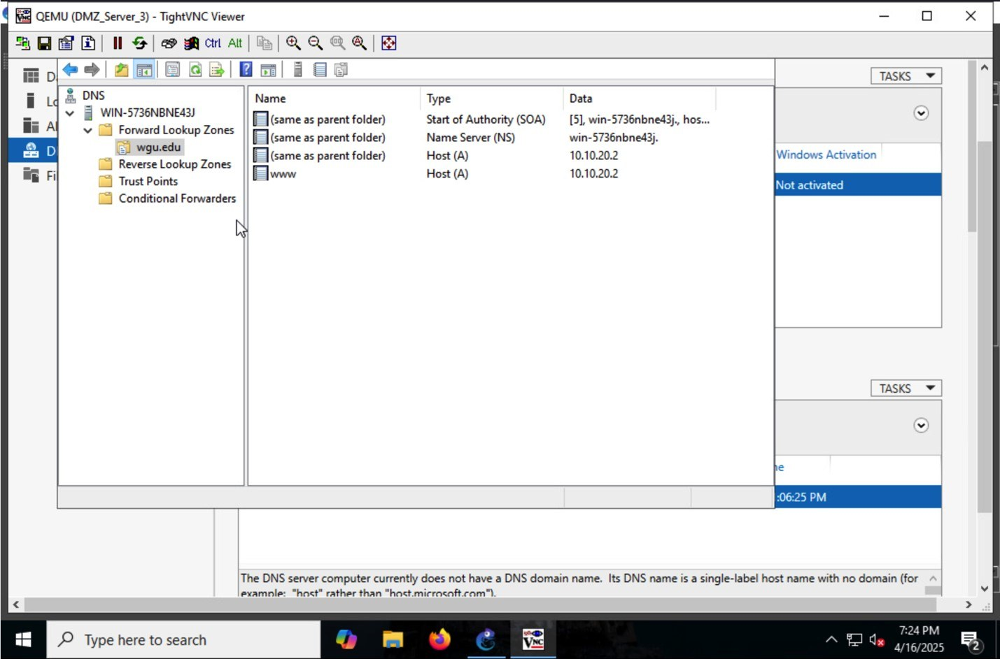

   *DNS Manager on DMZ_Server_3: the wgu.edu zone's parent and www Host (A) records both point to 10.10.20.2.*

4. This incorrect IP address (10.10.20.2) explained why users were being redirected to a suspicious site — the DNS server was resolving wgu.edu to an IP address that hosted potentially malicious content
5. To resolve the issue, deleted the entire forward lookup zone for wgu.edu

   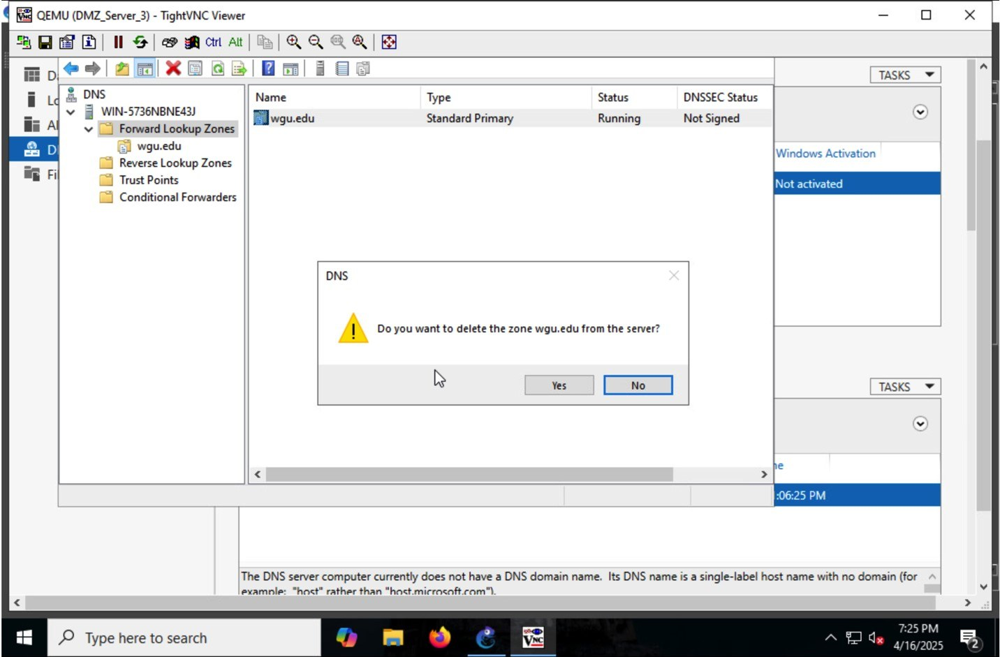

   *Deleting the wgu.edu forward lookup zone from DMZ_Server_3.*

6. After deletion, verified that users would now resolve wgu.edu via the organization's upstream DNS providers, which have the correct records
7. Verified the resolution by testing access to www.wgu.edu, which now successfully loaded the legitimate WGU website

   

   *www.wgu.edu now loads the legitimate WGU site.*

8. Since DNS changes propagate throughout the organization automatically, this resolution is organization-wide as required

**Root cause:** Incorrect Host (A) records in the wgu.edu forward lookup zone, introduced during the recent server work, resolved the domain to 10.10.20.2.

**Recommendation**

- Audit the remaining forward lookup zones on DMZ_Server_3 for records added during the same maintenance window
- Determine whether the records were a configuration error or were planted, and treat 10.10.20.2 as suspect until that is settled
- Restrict who can modify zone records and enable DNS change logging
- Back up zone files before server maintenance so a bad change can be rolled back rather than reconstructed

---

## Ticket 2: Unauthorized FTP Service

**Reported**
```
A complaint came in that the organization is hosting an illegal FTP site to download copyrighted
software. The security team provided a pcap file capturing all FTP traffic on the network and
asked for the host.
```

**Tools used:** Wireshark

**Why this tool:** Wireshark is the standard tool for reading packet captures, and its display filters isolate a single protocol out of a large capture.

**Troubleshooting process**

1. Opened the provided pcap file in Wireshark
2. Applied the display filter `ftp or ftp-data` to isolate only FTP-related traffic
3. Examined the filtered packets to identify FTP server communications
4. Found evidence of an FTP server at IP address 10.10.20.2 advertising itself as a "warez FTP service"
5. Observed successful anonymous login to the server
6. Identified navigation to common warez directories including "pub"
7. Found directory listing commands and evidence of file sharing activity
8. Confirmed the FTP server was explicitly labeled as providing "warez" content

   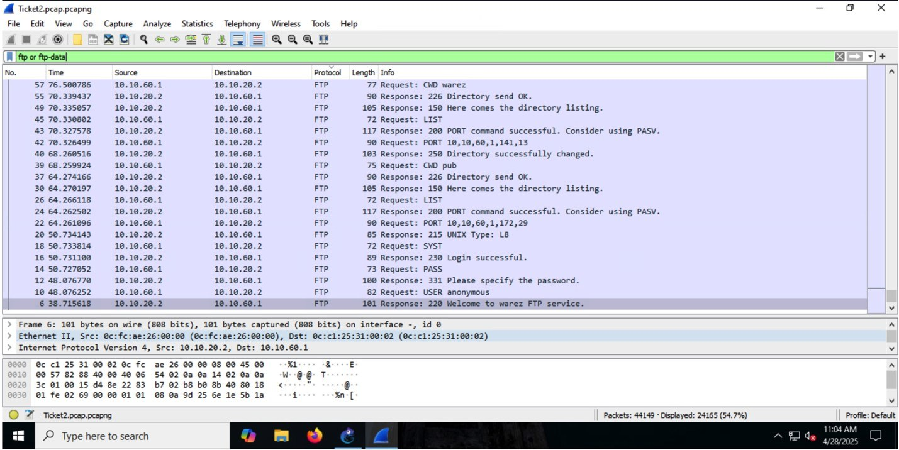

   *Wireshark filtered on `ftp or ftp-data`: 10.10.20.2 answers "220 Welcome to warez FTP service", accepts `USER anonymous` ("230 Login successful"), and the client changes into `pub` and `warez` and lists directories.*

**Root cause:** An FTP service running on 10.10.20.2 in the DMZ, accepting anonymous logins and serving unauthorized content.

**Recommendation**

- Block traffic to and from 10.10.20.2 at the firewall
- Isolate the system for forensic review
- Determine whether the host was compromised or deliberately configured this way
- Review access logs to identify who connected
- Add recurring network scanning to detect unauthorized services
- Update acceptable use policy to prohibit unapproved file sharing services

---

## Ticket 3: Linux Server Cannot Reach Any Network

**Reported**
```
The host "Ubuntu_Server" cannot get to any of the assigned networks or the internet, which is
preventing the server from pulling required security patches. The resolution must be
organization-wide.
```

**Tools used:** `ip`, ping, traceroute, PuTTY, VyOS CLI

**Why these tools:** `ip` shows interface and routing state, ping and traceroute isolate where the path breaks, and PuTTY plus the VyOS CLI gave access to correct the router configuration.

**Troubleshooting process**

1. Used ping from Ubuntu_Server to test connectivity to loopback, local gateway, and internet addresses
2. Ran traceroute to 8.8.8.8 which revealed a routing loop between Router4 and Router5

   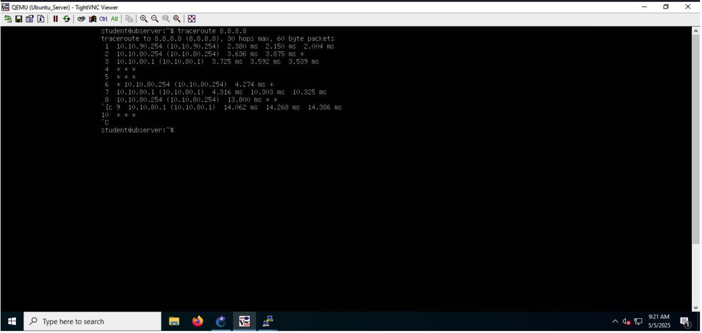

   *traceroute from Ubuntu_Server bounces between 10.10.80.254 and 10.10.80.1 — a routing loop.*

3. Accessed Router4 and examined its routing table with the `ip route` command
4. Discovered Router4 had an incorrect default route pointing to 10.10.80.1 instead of 10.10.70.254

   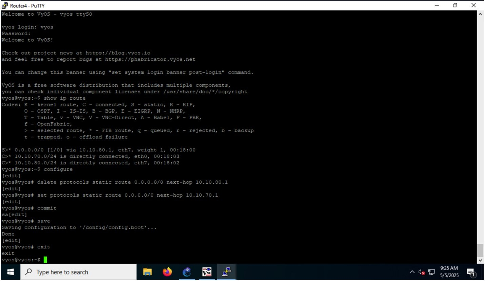

   *Router4 `show ip route`: the default route points back to 10.10.80.1. The static default route is then deleted and replaced.*

   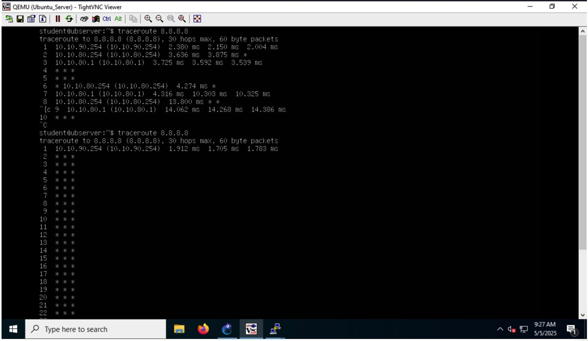

   *Re-running traceroute after the change: the loop is gone, but traffic still stops after the first hop.*

5. Identified lack of NAT configuration on Router4 and Router5 for internet traffic
6. Noted absence of dynamic routing protocols across the network
7. Implemented NAT masquerade rules on Router4 and Router5

   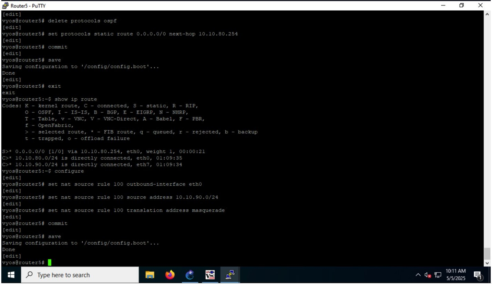

   *Router5: default route set to 10.10.80.254 and a NAT masquerade rule added for 10.10.90.0/24.*

   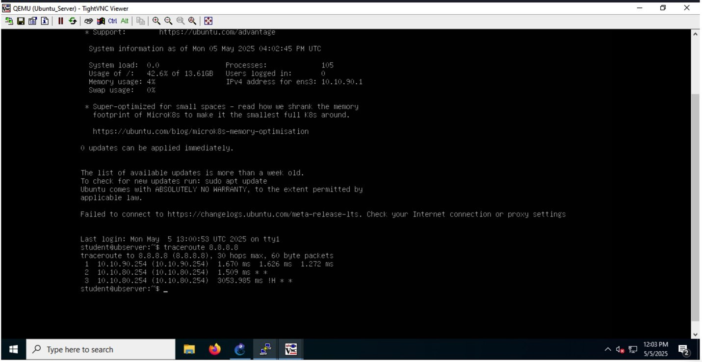

   *Progress check: traffic now reaches 10.10.80.254 but returns host unreachable (`!H`) — the routers still need a shared view of the network.*

8. Configured OSPF on all routers to provide dynamic routing across the organization

   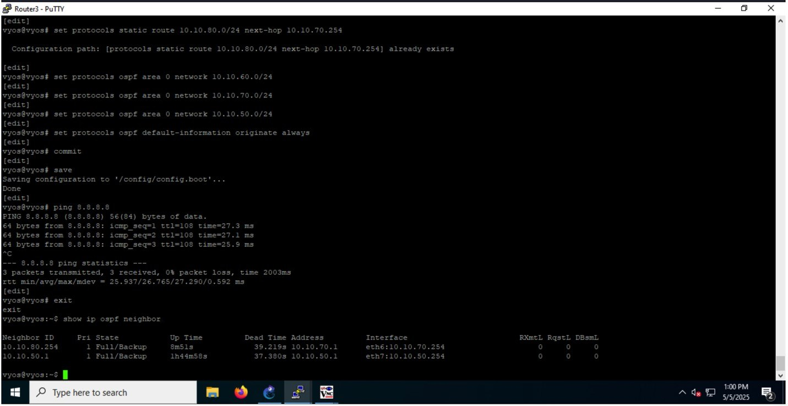

   *Router3: OSPF networks added with `default-information originate always`, a ping to 8.8.8.8 succeeds, and `show ip ospf neighbor` lists both neighbors as Full.*

9. Verified connectivity with ping and traceroute from Ubuntu_Server to internet addresses

   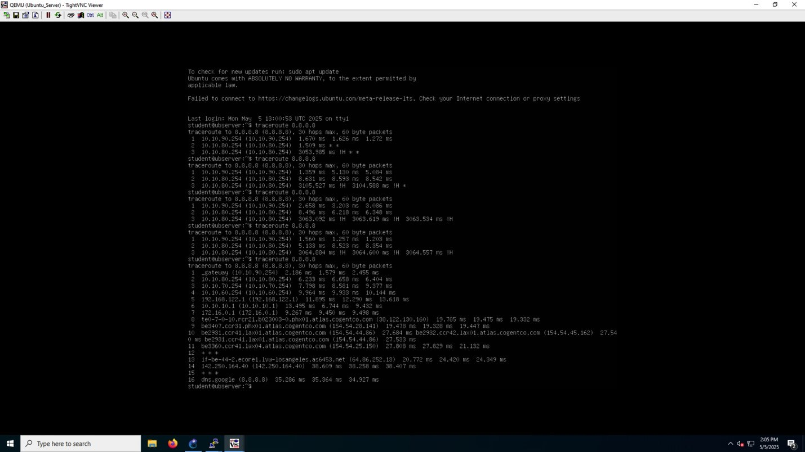

   *Final traceroute from Ubuntu_Server reaches dns.google (8.8.8.8).*

**Root cause:** Router4's default route pointed backward instead of forward to Router3, creating a routing loop. With no dynamic routing protocol, there was no path around the error.

**Recommendation:** Beyond the immediate fix, run periodic configuration audits so static route errors are caught before they affect services.

---

## Ticket 4: Workstation Has No Network Access

**Reported**
```
A user cannot access the internet or network resources on his company laptop (Windows_Laptop_1)
when it is connected via ethernet cable to the office network.
```

**Tools used:** ipconfig, Windows Network Troubleshooter, Network and Sharing Center, network diagram

**Why these tools:** ipconfig shows the live address assignment, the troubleshooter gives a fast first read, and the network diagram provided the correct addressing scheme for the subnet.

**Troubleshooting process**

1. Confirmed the laptop was connected but showing "No Internet access"

   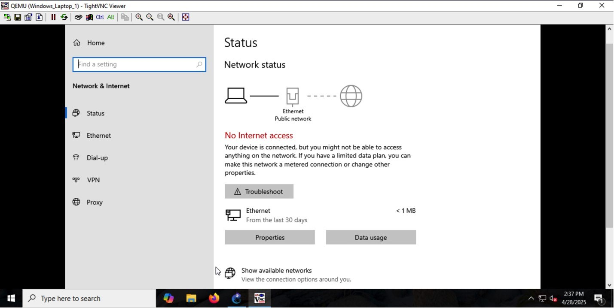

   *Network status on Windows_Laptop_1: connected, but No Internet access.*

2. Ran the Windows Network Troubleshooter, which reported "Ethernet doesn't have a valid IP configuration"

   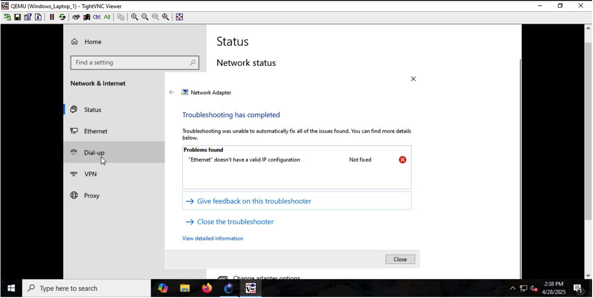

   *The troubleshooter reports "Ethernet" doesn't have a valid IP configuration — not fixed.*

3. Ran ipconfig and found an APIPA address (169.254.x.x) rather than an address from the user subnet

   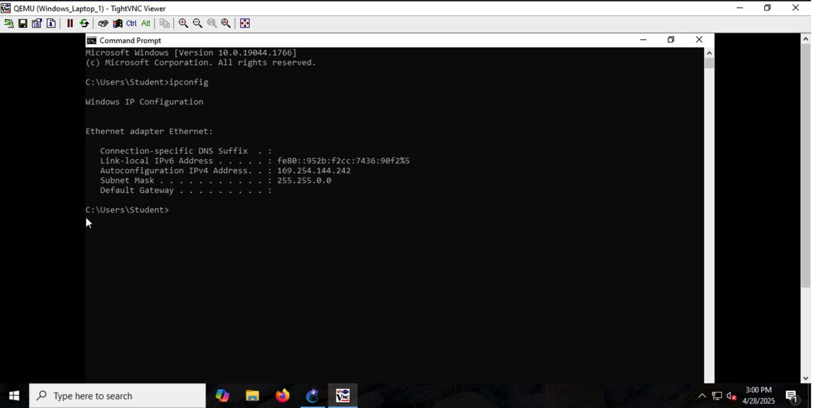

   *`ipconfig` shows the APIPA address 169.254.144.242 with no default gateway.*

4. Checked the network diagram and a working workstation on the same subnet to confirm the correct scheme
5. Switched the adapter from DHCP to manual and set:
   - IP address: 10.10.40.4
   - Subnet prefix length: 24
   - Default gateway: 10.10.40.254
   - DNS server: 10.10.20.3

   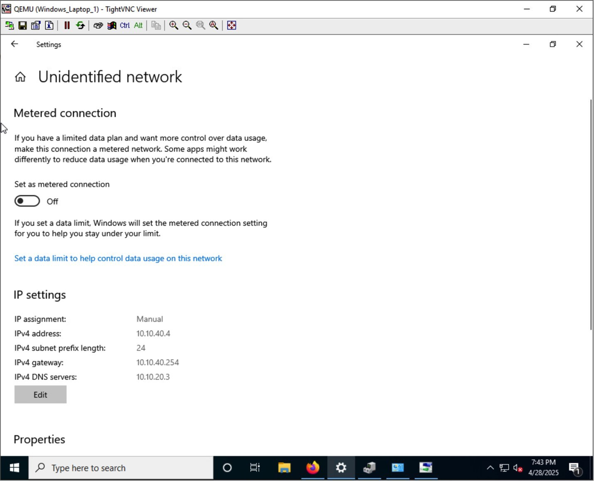

   *IP settings after the change: Manual, 10.10.40.4/24, gateway 10.10.40.254, DNS 10.10.20.3.*

6. Verified internet and internal resource access were restored

   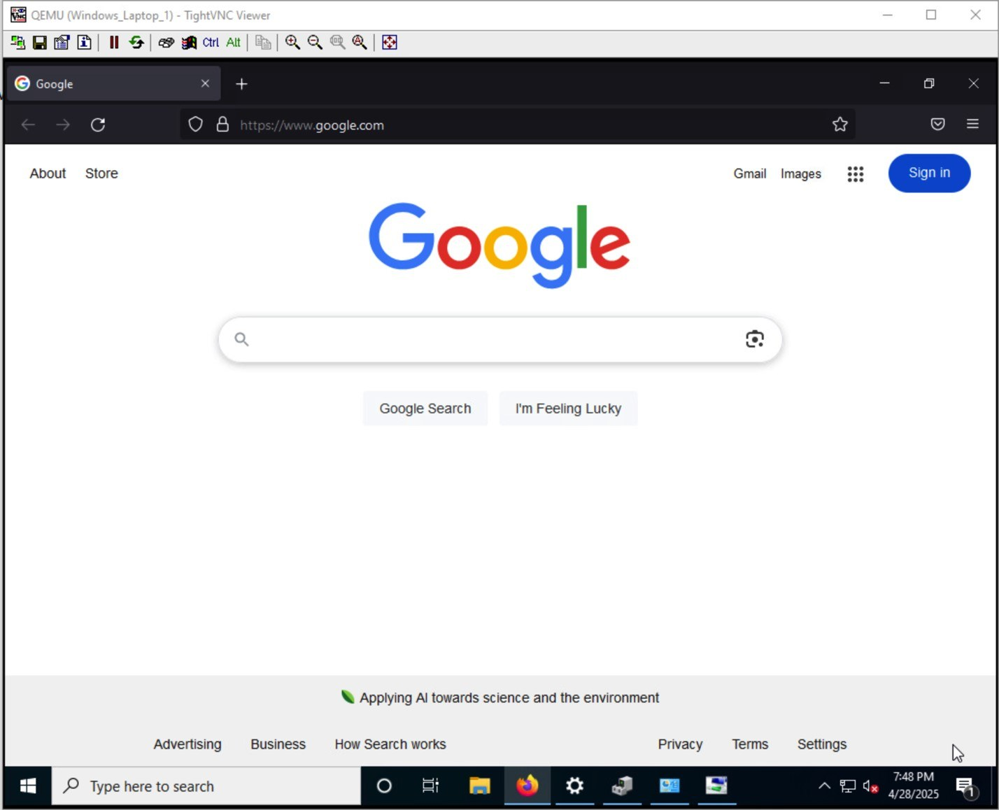

   *The browser loads google.com — access restored.*

**Root cause:** The workstation could not obtain a lease from DHCP and fell back to an APIPA address, which provides no connectivity beyond the local link. Possible causes include a DHCP service problem, a firewall blocking DHCP, or an adapter issue.

**Recommendation**

- Treat the static assignment as a temporary measure — it restores this one user, not the underlying DHCP path
- Verify DHCP service health and scope availability for the user subnet, and check the relay if the scope lives on another segment
- Document the addressing scheme with reserved static ranges
- Add connectivity monitoring so DHCP failures surface before users report them

---

## Ticket 5: DMZ Server Unreachable After a Firewall Change

**Reported**
```
A coworker states that she worked on a ticket to allow access through the firewall to
DMZ_Server_1. There is now no access to the server from any device outside its network.
```

**Tools used:** ping, nslookup, tracert, pfTop, OPNsense shell, OPNsense web interface

**Why these tools:** ping and tracert establish whether and where the path breaks. nslookup ruled out name resolution as the cause. pfTop showed live connections through the firewall. Shell access exposed the active ruleset, and the web interface made the change safe and reviewable.

**Troubleshooting process**

1. Pinged DMZ_Server_1 by hostname and got a name resolution failure; nslookup also failed against the configured DNS server, so the host was tested by IP from that point on

   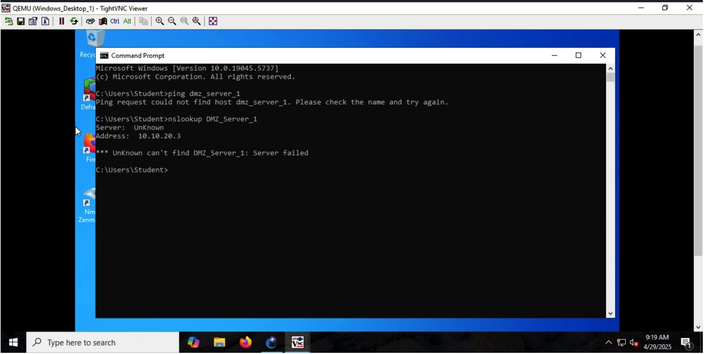

   *`ping dmz_server_1` cannot find the host, and `nslookup DMZ_Server_1` returns "Server failed".*

2. Pinged 10.10.20.3 directly and received "Request timed out" on all four attempts — 100% packet loss
3. Ran tracert to 10.10.20.3 and found traffic reaching hops 1 through 4 (10.10.40.254, 10.10.10.254, 10.10.50.254, 10.10.60.254) and timing out after the firewall

   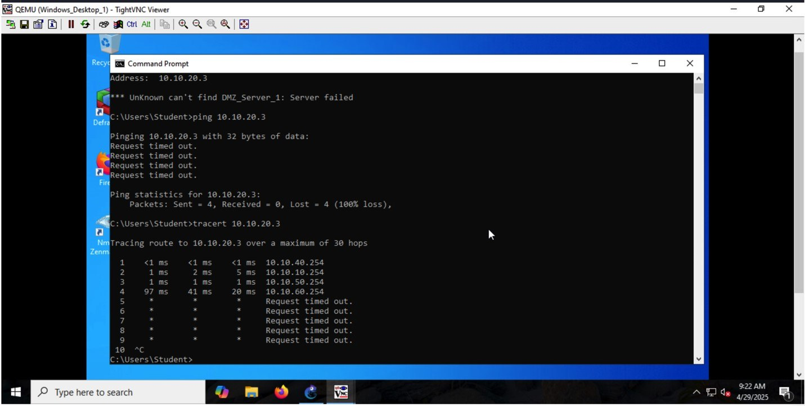

   *`ping 10.10.20.3` times out with 100% loss, and `tracert` stops after hop 4 (10.10.60.254).*

4. Opened the firewall console and used pfTop to examine current connections
5. Read the active ruleset and found `block return out quick on em2 inet from any to 10.10.20.1` — a block against the DMZ gateway carrying the `quick` keyword, which stops evaluation before any later allow rules
6. Confirmed the rule in the web interface and deleted it

   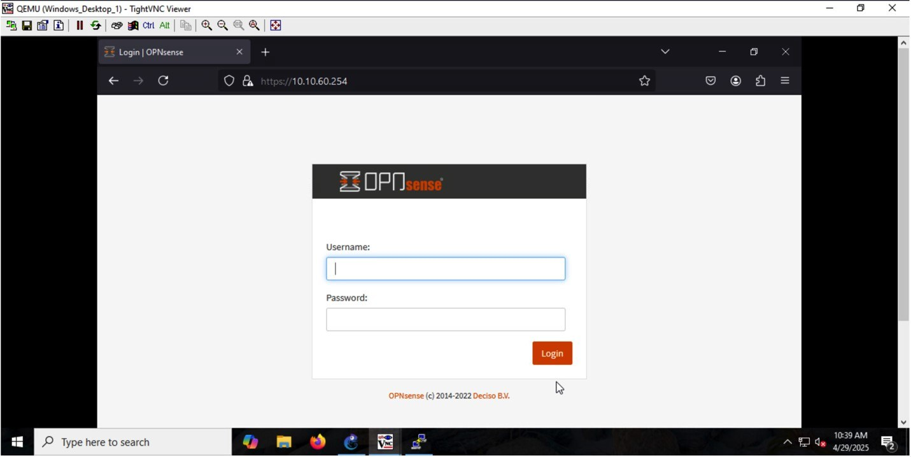

   *Signing in to the OPNsense web interface at 10.10.60.254.*

   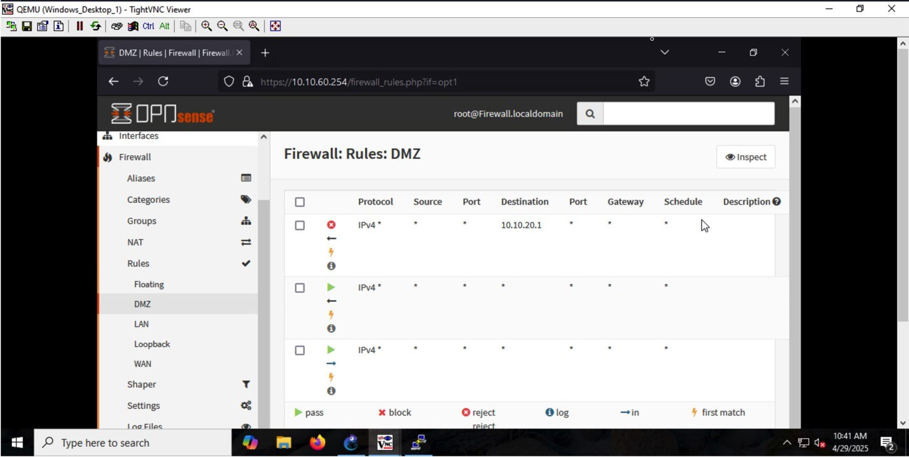

   *Firewall: Rules: DMZ — a block rule with destination 10.10.20.1 sits above the pass rules.*

   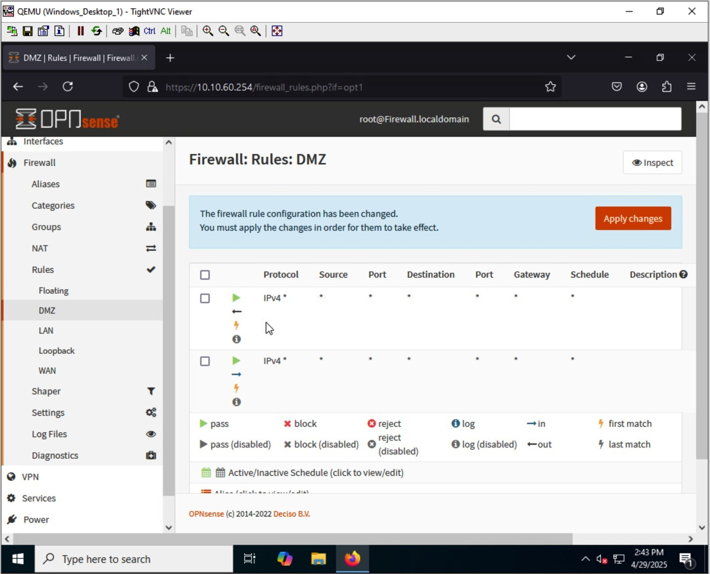

   *The DMZ ruleset after the block rule was deleted, ready to apply.*

7. Verified connectivity to DMZ_Server_1 was restored

**Root cause:** A block rule against the DMZ gateway, added during the earlier change, prevented external traffic from reaching hosts behind it. The `quick` keyword caused it to short-circuit the rest of the ruleset.

**Recommendation**

- Replace broad block rules with specific allow rules scoped to the service that actually needed opening
- Require a peer review and a written rollback step before firewall changes reach production
- Snapshot the ruleset before each change so a bad rule can be reverted rather than hunted down
- Add descriptions to firewall rules so the intent behind each one is readable later

---

## Ticket 6: Services Outside the Approved Baseline

**Reported**
```
The cybersecurity team is requesting to know what ports are open on DMZ_Server_2 to identify
services running outside the permitted services. Permitted services are 22/ssh, 135/msrpc,
3389/ms-wbt-server, and 8080/http-proxy.
```

**Tools used:** nmap (network port scanner), `ip addr` (network interface configuration)

**Why these tools:** nmap is a port scanning tool that identifies open ports and the services behind them. `ip addr` confirmed the actual IP address of DMZ_Server_2.

**Troubleshooting process**

1. Accessed DMZ_Server_2 directly via console and ran `ip addr` to find its IP (10.10.20.2)
2. Used the `nmap -p-` command to scan for open ports

   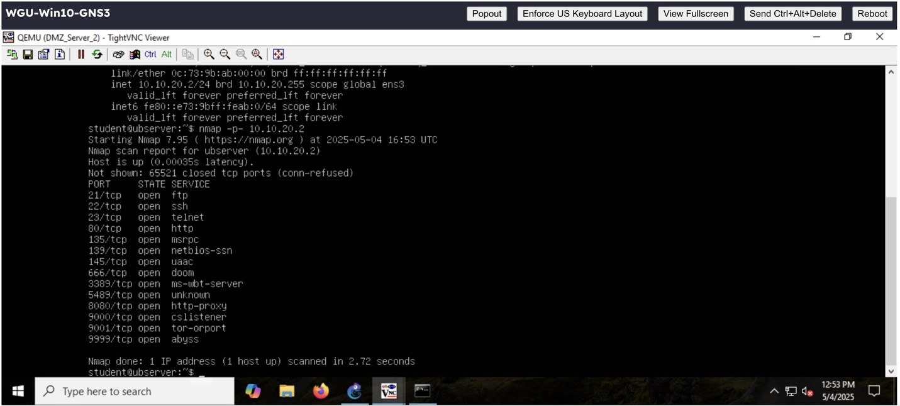

   *`ip addr` confirms 10.10.20.2, and `nmap -p- 10.10.20.2` lists every open port.*

3. Compared scan results with the list of permitted services
4. Identified multiple unauthorized open ports and services

**Findings — services outside the approved baseline**

| Port | Service |
|---|---|
| 21/tcp | FTP |
| 23/tcp | Telnet |
| 80/tcp | HTTP |
| 139/tcp | NetBIOS-SSN |
| 145/tcp | UAAC |
| 666/tcp | Doom |
| 5489/tcp | Unknown |
| 9000/tcp | CSListener |
| 9001/tcp | Tor ORPort |
| 9999/tcp | Abyss |

**Risk:** Each unapproved service widens the attack surface. Telnet and FTP carry credentials in cleartext. A Tor ORPort listener on a DMZ host is a strong indicator the system warrants investigation rather than just remediation.

**Recommendation**

- Close the unapproved ports with a host-based firewall
- Disable services not required for business operations; document and get approval for any that are
- Investigate the host, given the nature of several of the listeners
- Restrict firewall policy to approved ports only
- Run scheduled port scans as part of routine monitoring
- Establish a baseline configuration standard for DMZ hosts

---

## Cross-ticket observation

Three tickets arrived separately but point at the same host, 10.10.20.2 (DMZ_Server_2):

- **Ticket 1** — the poisoned wgu.edu A records resolved to 10.10.20.2, so redirected users were being sent to this host
- **Ticket 2** — the unauthorized FTP service in the packet capture is running on 10.10.20.2
- **Ticket 6** — the port scan of 10.10.20.2 shows FTP listening on 21/tcp alongside a Tor ORPort listener and eight other unapproved services

Handled as three unrelated tickets, each gets a local fix. Read together, they describe one compromised DMZ host being used to redirect internal users and serve unauthorized content. That reframes the response from remediation to incident investigation.

---

## Skills demonstrated

- Ticket handling from report through verified resolution
- Root cause analysis and written documentation
- Tool selection with stated rationale
- Windows client and server support: DNS, DHCP, addressing, adapter configuration
- Linux server troubleshooting and CLI administration
- Routing: static routes, OSPF, NAT, loop diagnosis
- Firewall rule analysis and change management
- Packet capture analysis and port scanning
- Correlating findings across separate tickets to identify a common root
